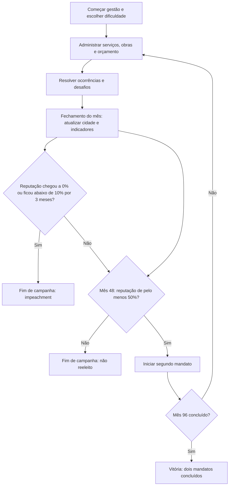

<div align="center">
  
  <h1>ProblemaCIDADE</h1>
  <p><strong>Administre a cidade. Resolva problemas. Conquiste a reeleição.</strong></p>
  <p>Um jogo educacional de gestão municipal feito por Pato Jogos (Duck Games).</p>
  <p>
    
    
    
    
  </p>
  <p>
    <a href="#sobre-o-jogo">Sobre</a> ·
    <a href="#como-jogar">Como jogar</a> ·
    <a href="#executar-o-projeto">Executar</a> ·
    <a href="#documentação">Documentação</a> ·
    <a href="#equipe">Equipe</a>
  </p>
</div>

---

## Sobre o jogo

**ProblemaCIDADE** é um simulador educacional de gestão municipal em que você assume a prefeitura de uma cidade, administra o orçamento e os serviços públicos e responde a problemas matemáticos ligados às decisões do governo.

A campanha tem **dois mandatos de 48 meses**. Para ser reeleito no mês 48, é preciso chegar a pelo menos **50% de reputação**; concluir o segundo mandato até o mês 96 encerra a campanha com vitória. As regras e os valores são parâmetros da simulação do jogo, não recomendações de política pública.

### O que você encontra

| Sistema | O que faz |
| --- | --- |
| **Gestão da cidade** | Acompanhe saldo, reputação, população, desemprego, fome e seis áreas de serviço. |
| **Serviços públicos** | Invista em educação, saúde, saneamento, segurança, cultura e assistência social. |
| **Construções** | Escolha lotes no mapa isométrico e acompanhe obras que levam 20 dias do jogo. |
| **Problemas e ocorrências** | Resolva desafios de proporção, juros, estatística, lógica, equações e grafos; ocorrências urgentes têm prazo. |
| **Ferramentas de apoio** | Use calculadora, lousa de rascunho e visualização de rotas quando disponíveis no problema. |
| **Ritmo de jogo** | Pause, escolha entre três velocidades ou avance até a próxima ocorrência. |
| **Projeções** | Consulte tendências para os seis meses seguintes após haver 6 observações mensais. |
| **Partidas salvas** | Mantenha até três slots de campanha. |

### Ciclo de gestão



## Como jogar

### Dificuldades

| Dificuldade | Reputação inicial | Problemas comuns por mês | Fator de orçamento |
| --- | :---: | :---: | :---: |
| Fácil | 60% | 0 | 1,12× |
| Médio | 52% | 1 | 1,00× |
| Difícil | 42% | 1 | 0,90× |

### Regras rápidas

- Você começa com **R$ 220.000**, população inicial entre ~6.800 e 10.000 habitantes (100 casas e 40–60 prédios residenciais) e seis serviços em **55 pontos**.
- Investimentos começam em **R$ 5.000**; cada R$ 7.500 acrescenta um ponto à área selecionada, até o limite do indicador.
- Uma construção custa **R$ 35.000** e leva **20 dias**. É possível manter até três obras em andamento, no máximo uma por área.
- O calendário tem 30 dias por mês. Um mês dura 1 minuto e 30 segundos no modo normal, 45 segundos no rápido e 15 segundos no muito rápido.
- O impeachment acontece se a reputação chegar a zero ou permanecer abaixo de 10% por três meses consecutivos.

### Controles

| Ação | Controle |
| --- | --- |
| Pausar ou retomar o tempo | `Espaço` |
| Avançar até a próxima ocorrência / pular feedback | `Enter` |
| Velocidades (Normal / Rápido / Muito rápido) | `1` / `2` / `3` |
| Abrir/fechar investimentos | `I` |
| Abrir/fechar reputação e finanças | `R` |
| Posicionar moradia pendente | `M` |
| Abrir problema urgente | `U` |
| Centralizar câmera | `C` |
| Abrir/fechar menu ou painéis | `Esc` |
| Mover a câmera | Arrastar com o botão esquerdo ou do meio do mouse |
| Aproximar ou afastar | Roda do mouse |
| Selecionar um lote no modo de construção | Clique esquerdo |
| Cancelar o posicionamento | `Esc` ou clique direito |

O HUD também oferece controles para pausa, velocidades, avanço até a próxima ocorrência e centralização da câmera.

## Executar o projeto

### Requisitos

- **Godot 4.7** (o projeto está configurado para essa versão).
- O preset de exportação incluído está configurado para **Windows Desktop**. A documentação do projeto também lista Windows e Linux como plataformas-alvo.

### Abrir no editor

1. Abra o Godot Project Manager e escolha **Importar**.
2. Selecione `godot/project.godot`.
3. Abra o projeto e pressione **F5** para executar o projeto a partir da cena principal.

### Executar pela linha de comando

A partir da raiz do repositório, com o executável do Godot disponível no `PATH`:

```bash
godot --path godot
```

No Windows, use `godot.exe --path godot` se esse for o nome do executável instalado.

### Testes de integração

Os scripts de verificação ficam em `godot/tests/integration/`. A partir da raiz do repositório, por exemplo:

```bash
godot --headless --path godot --script res://tests/integration/test_campaign.gd
godot --headless --path godot --script res://tests/integration/test_city_layout.gd
```

## Estrutura do repositório

| Pasta | Conteúdo |
| --- | --- |
| [`godot/`](godot/) | Jogo atual: cenas, scripts GDScript, assets, localização e testes. |
| [`docs/`](docs/) | GDD, documento de requisitos e diagramas PlantUML. |
| [`imgs/`](imgs/) | Recursos gráficos do projeto e imagens de funcionalidades. |
| [`src/`](src/) | Protótipo conceitual anterior em Java; não é a versão atual do jogo. |
| [`site/`](site/) | Arquivos HTML e CSS da página de apresentação. |

## Documentação

- [Game Design Document (GDD)](docs/GDD.md) — conceito, regras, economia, eventos, interface e arquitetura.
- [Documento de requisitos (PDF)](docs/Documentação-latex.pdf) — requisitos funcionais e não funcionais do projeto.
- [Fluxo de telas](docs/diagrams/fluxo_telas.puml), [ciclo de jogo](docs/diagrams/core_loop.puml), [ciclo de eventos](docs/diagrams/ciclo_eventos.puml) e [arquitetura](docs/diagrams/arquitetura.puml) — diagramas PlantUML.
- [Página de apresentação](site/index.html) — versão local em HTML/CSS.

<details>
  <summary>Requisitos de sistema previstos na documentação</summary>

  Os valores abaixo são requisitos definidos no documento do projeto; não representam resultados de benchmark:

  - **Mínimo previsto:** Windows 10/11 de 64 bits ou Debian Linux, 4 GB de RAM, processador Intel Pentium ou equivalente e gráficos integrados Intel.
  - **Recomendado previsto:** 8 GB de RAM, Intel Core i3 de 3ª geração ou superior e GPU GTX 550.
  - O documento prevê 30–60 FPS na configuração mínima e acima de 60 FPS na recomendada.
</details>

## Equipe

**Pato Jogos (Duck Games)**

- Beatriz Leonardo Fernandes da Silva
- Camilo Handal Batista de Oliveira
- Débora Luiza de Paula Ferreira
- Guilherme Nascimento Bilibio
- Henrique Daisuke Akiyama

---

<p align="center">
  Feito como projeto interdisciplinar de <strong>Teoria e Desenvolvimento de Sistemas</strong>,
  <strong>Matemática Computacional</strong> e <strong>Desenvolvimento Web 2</strong>.
  <br />
  <a href="https://github.com/Jogojava/ProblemaCIDADE">Repositório no GitHub</a>
</p>
