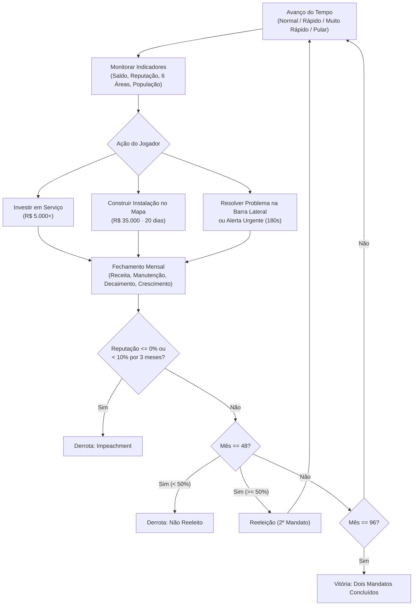
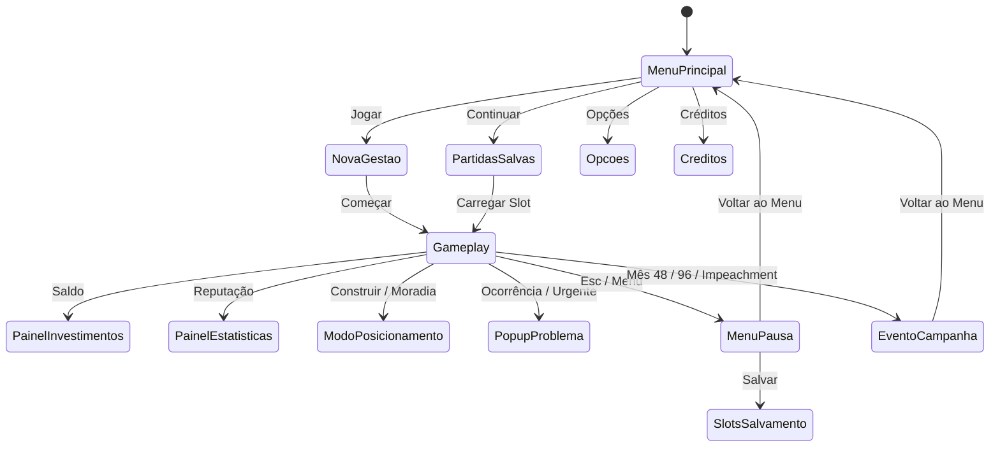

# Game Design Document (GDD) — ProblemaCIDADE

> **Estúdio:** Pato Jogos (*Duck Games*)  
> **Versão do Documento:** 1.0  
> **Engine:** Godot 4.7 (`Forward Plus` / `gl_compatibility`)  
> **Idiomas Suportados:** Português do Brasil (`pt_BR`, padrão) e Inglês (`en`)  
> **Contexto:** Projeto interdisciplinar para as disciplinas de *Teoria e Desenvolvimento de Sistemas*, *Matemática Computacional* e *Desenvolvimento Web 2*.

---

## Sumário

1. [Visão Geral do Projeto](#1-visão-geral-do-projeto)
2. [Conceito Central e Loop de Gameplay](#2-conceito-central-e-loop-de-gameplay)
3. [Regras de Simulação e Balanceamento](#3-regras-de-simulação-e-balanceamento)
4. [Sistema de Tempo e Calendário](#4-sistema-de-tempo-e-calendário)
5. [Sistema de Eventos e Problemas Matemáticos](#5-sistema-de-eventos-e-problemas-matemáticos)
6. [Mapa Isométrico, Construções e Crescimento Urbano](#6-mapa-isométrico-construções-e-crescimento-urbano)
7. [Interface (UI/UX), Direção de Arte e Áudio](#7-interface-uiux-direção-de-arte-e-áudio)
8. [Arquitetura Técnica e Persistência](#8-arquitetura-técnica-e-persistência)
9. [Equipe e Créditos](#9-equipe-e-créditos)
10. [Histórico, Protótipo e Ideias Futuras](#10-histórico-protótipo-e-ideias-futuras)

---

## 1. Visão Geral do Projeto

### 1.1 Resumo Executivo (*High Concept*)
**ProblemaCIDADE** é um jogo educacional de **gestão municipal 2D isométrica** combinado com **desafios matemáticos e lógicos**. O jogador assume o papel de prefeito(a) de uma cidade recém-iniciada (por padrão, *Vila Esperança*) e precisa equilibrar orçamento público, qualidade dos serviços, expansão urbana e aprovação popular ao longo de **dois mandatos consecutivos (8 anos / 96 meses)**, tomando decisões embasadas na resolução de problemas cotidianos e emergenciais.

### 1.2 Pilares de Design
- **Matemática aplicada à gestão pública:** cada ocorrência da cidade traduz um conceito de Matemática Computacional ou Matemática Básica (juros, proporção, lógica proposicional, grafos, combinatória, estatística, equações) em uma decisão concreta de governo.
- **Consequência sistêmica legível:** acertos, erros, atrasos, investimentos e obras refletem diretamente no caixa, na reputação, nos 6 indicadores de serviço, na população e no mapa da cidade.
- **Ferramentas de raciocínio integradas:** o jogador não precisa sair do jogo para fazer contas — o modal de problemas oferece uma **Lousa de Rascunho** (com salvamento automático de traços) e uma **Calculadora Integrada**.
- **Acessibilidade e controle de ritmo:** o tempo pode ser pausado a qualquer momento, acelerado em 3 velocidades ou avançado diretamente até a próxima ocorrência.

### 1.3 Ficha Técnica
| Item | Especificação |
| :--- | :--- |
| **Gênero** | Simulador de Gestão Municipal / Educacional / Puzzle Matemático |
| **Plataforma Alvo** | Desktop (Windows / Linux via Godot 4.7) |
| **Resolução Base** | 1920 × 1080 (`canvas_items`, `expand`; mínimo 1024 × 720) |
| **Modos de Vídeo** | Janela, Tela Cheia, Janela sem Borda (`1280×720`, `1600×900`, `1920×1080`) |
| **Público-Alvo** | Estudantes do Ensino Médio / Técnico / Superior e interessados em jogos de estratégia casual |
| **Sessão Média** | 15 a 45 minutos por campanha (ajustável pela velocidade do tempo e botão de avanço) |

---

## 2. Conceito Central e Loop de Gameplay

### 2.1 Objetivo e Condições de Vitória / Derrota
A campanha é estruturada em **dois mandatos de 4 anos** (48 meses cada, totalizando 96 meses):

| Evento de Campanha | Condição | Resultado |
| :--- | :--- | :--- |
| **Reeleição** | Atingir o **Mês 48** com Reputação $\ge 50\%$ | Inicia o **2º Mandato** (meses 49 a 96) |
| **Vitória (Campanha Concluída)** | Atingir o **Mês 96** sem sofrer impeachment | Fim de jogo positivo — *Dois mandatos concluídos* |
| **Derrota — Não Reeleito** | Atingir o **Mês 48** com Reputação $< 50\%$ | Fim de jogo — *A reeleição não foi alcançada* |
| **Derrota — Impeachment** | Reputação $\le 0\%$ **ou** Reputação $< 10\%$ por **3 meses consecutivos** | Fim de jogo imediato — *Mandato encerrado por impeachment* |

### 2.2 Core Loop
> Diagrama PlantUML completo: [`docs/diagrams/core_loop.puml`](diagrams/core_loop.puml)

---

## 3. Regras de Simulação e Balanceamento

Todas as constantes centrais ficam concentradas em `godot/game/game_rules.gd` (`GameRules`) e executadas em `godot/game/state/city_state.gd` (`CityState`).

### 3.1 Níveis de Dificuldade
| Dificuldade | Reputação Inicial | Fator de Ganho (Rep.) | Fator de Perda (Rep.) | Problemas Comuns/Mês | Multiplicador de Orçamento |
| :--- | :---: | :---: | :---: | :---: | :---: |
| **Fácil** (`easy`) | 65% | 1,25× | 0,75× | 1 | 1,15× |
| **Médio** (`medium`) | 55% | 1,00× | 1,00× | 2 | 1,00× |
| **Difícil** (`hard`) | 45% | 0,80× | 1,20× | 3 | 0,90× |

### 3.2 Parâmetros Iniciais e Constantes
| Parâmetro | Valor |
| :--- | :--- |
| Saldo Inicial (`INITIAL_FUNDS`) | R\$ 250.000,00 |
| População Inicial (`INITIAL_POPULATION`) | 10.000 habitantes |
| Moradias Iniciais (`INITIAL_HOMES`) | 18 residências |
| Nível Inicial de cada Serviço | 55 / 100 |
| Desemprego Inicial / Fome Inicial | 12,0% / 10,0% |
| Investimento Mínimo | R\$ 5.000,00 (slider até R\$ 50.000,00 em passos de R\$ 5.000,00) |
| Custo por Ponto de Investimento | R\$ 3.000,00 = +1 ponto na área |
| Custo e Prazo de Obra | R\$ 35.000,00 · 20 dias |
| Limite de Obras Simultâneas | 3 obras (máximo de 1 por área simultaneamente) |
| Limite Total de Instalações Públicas | 30 instalações (concluídas + em andamento) |

### 3.3 Áreas de Serviço e Instalações
| ID | Área de Serviço | Instalação Construível | Símbolo no Mapa |
| :--- | :--- | :--- | :---: |
| `education` | Educação | Escola | `E` |
| `health` | Saúde | Unidade de saúde | `+` |
| `water` | Saneamento | Estação de saneamento | `~` |
| `security` | Segurança | Posto de segurança | `S` |
| `culture` | Cultura | Centro cultural | `C` |
| `social` | Assistência social | Centro de assistência | `A` |

### 3.4 Fórmulas da Economia e Indicadores (Fechamento Mensal)
A cada virada de mês (`advance_month`):

1. **Fluxo de Caixa Mensal:**
   $$\text{Receita} = \text{População} \times 12 \times \text{FatorOrçamento}$$
   $$\text{Manutenção} = 102.000 + (\text{QtdInstalações} \times 700)$$
   $$\text{Saldo} \leftarrow \text{Saldo} + (\text{Receita} - \text{Manutenção})$$

2. **Decaimento dos Serviços:**
   Todas as 6 áreas sofrem decaimento natural de **$-0,5$ ponto/mês** (limitado entre 0 e 100).

3. **Indicadores Sociais Derivados:**
   - **Desemprego:** $\text{clamp}(18,0 - 0,1 \times \text{Educação} - 0,1 \times \text{QtdInstalações},\; 2,0,\; 35,0)$
   - **Fome:** $\text{clamp}(20,0 - 0,2 \times \text{AssistênciaSocial},\; 0,0,\; 40,0)$

4. **Variação Mensal de Reputação:**
   Seja $\bar{S}$ a média aritmética das 6 áreas de serviço:
   $$\Delta \text{Rep}_{\text{bruto}} = \frac{\bar{S} - 50}{25} - \begin{cases} 3,0 & \text{se Saldo} < 0 \\ 0,0 & \text{caso contrário} \end{cases}$$
   O delta é multiplicado pelo fator de ganho ou perda da dificuldade e limitado em $[0, 100]$.

5. **Investimentos e Conclusão de Obras:**
   - **Investir valor $V$:** $\Delta \text{Área} = +\frac{V}{3000}$, $\Delta \text{Rep}_{\text{bruto}} = +\min(3,0,\; \frac{V}{15000})$.
   - **Concluir obra (após 20 dias):** $+12$ pontos na área correspondente e $+3,0$ de reputação bruta.

6. **Crescimento Populacional e Moradias:**
   - Se $\bar{S} \ge 45,0$: a população cresce $+50 + \lfloor \max(0, \bar{S} - \bar{S}_{\text{anterior}}) \times 75 \rfloor$ habitantes.
   - A cada **150 novos habitantes** acima dos 10.000 iniciais, surge demanda por **1 nova moradia**.
   - Quando a média dos serviços melhora em relação ao mês anterior, moradias são geradas automaticamente em lotes livres; o jogador também pode posicionar moradias pendentes manualmente pelo botão de População/Moradias no HUD.

7. **Projeção Linear de 6 Meses (`ProjectionChart`):**
   - Disponível no painel de Estatísticas após **12 snapshots mensais**.
   - Calcula a regressão linear simples (mínimos quadrados) sobre as últimas 12 observações de qualquer um dos 10 indicadores (`Saldo`, `Reputação`, 6 serviços, `Desemprego`, `Fome`) e projeta a tendência tracejada para os próximos **6 meses**.

---

## 4. Sistema de Tempo e Calendário

Gerenciado por `TimeManager` (`godot/scripts/timemanager.gd`):

- **Estrutura do Calendário:** 30 dias/mês, 12 meses/ano (360 dias/ano).
- **Velocidades:**
  | Velocidade | Duração real de 1 mês | Multiplicador |
  | :--- | :---: | :---: |
  | **Normal** | 180 s (3 min) | 1× |
  | **Rápido** | 90 s (1 min 30 s) | 2× |
  | **Muito Rápido** | 30 s | 6× |
- **Pausa Contextual por Motivos (`hold` / `release`):** o relógio é pausado automaticamente quando há menu de pausa (`menu`), painel aberto (`panel`), diálogo modal (`dialog`), modo de construção (`placement`), desafio não-urgente (`challenge`), janela sem foco (`inactive`, configurável) ou fim de campanha (`ended`).
- **Atalho de Pausa Manual:** tecla `Espaço` (desabilitada durante problemas e painéis).
- **Avançar até a Próxima Ocorrência (`SkipButton`):** simula dia a dia (com limite de 360 dias por clique) processando receitas, obras e eleições normalmente até surgir um evento ativo ou o fim da campanha, abrindo automaticamente o primeiro evento encontrado.

---

## 5. Sistema de Eventos e Problemas Matemáticos

> Diagrama de sequência PlantUML: [`docs/diagrams/ciclo_eventos.puml`](diagrams/ciclo_eventos.puml)

### 5.1 Categorias, Frequência e Peso
| Categoria | Peso | Frequência/Mês | Janela de Disparo | Prazo de Expiração | Recompensa (Acerto) | Penalidade (Erro/Expiração) |
| :--- | :---: | :---: | :---: | :--- | :--- | :--- |
| **Opcional** (`optional`) | 1× | 1 | Dias 2–28 | 30 dias (28 gerados) | +R\$ 4.000 · +1,5 rep. | -R\$ 2.000 · -1,5 rep. *(expirar: 0)* |
| **Comum** (`common`) | 2× | 1 / 2 / 3 *(por dif.)* | Dias 2–28 | 30 dias (28 gerados) | +R\$ 8.000 · +3,0 rep. | -R\$ 4.000 · -3,0 rep. |
| **Prioritário** (`important`) | 3× | 1 | Dias 5–25 | 30 dias (28 gerados) | +R\$ 12.000 · +4,5 rep. | -R\$ 6.000 · -4,5 rep. |
| **Urgente** (`urgent`) | 4× | 1 *(garantido)* | Dias 10–25 | **180 s em tempo real** | +R\$ 16.000 · +6,0 rep. | -R\$ 8.000 · -6,0 rep. |

> **Regras especiais de Problemas Urgentes:**
> - Ao disparar um problema urgente, a velocidade do jogo é reduzida automaticamente para **Normal**.
> - Diferente dos demais problemas (que pausam o relógio ao abrir), **o cronômetro de 180s continua correndo** enquanto o popup urgente está aberto (fases `PARA ABRIR` e `PARA RESPONDER`).
> - Existe no máximo 1 urgente por mês; se houver fila acumulada, o próximo só inicia sua contagem após o atual ser resolvido ou expirar.

### 5.2 Tipos de Interação e Ferramentas de Apoio
- **Múltipla Escolha (`choice`):** até 4 alternativas com suporte a múltiplas respostas válidas (`accepted_answers`) e efeitos específicos por escolha (`choice_effects`, ex.: *MedicaMOVImentos*).
- **Entrada Numérica (`number_input`):** aceita vírgula ou ponto decimal com tolerância configurável (padrão `0.01`).
- **Entrada de Texto (`text_input`):** comparação case-insensitive com lista de respostas aceitas.
- **Lousa de Rascunho (`ProblemBoard`):** camada translúcida sobre o enunciado para desenho livre com o mouse; preserva os traços e o texto digitado caso o jogador feche e reabra o problema.
- **Calculadora Integrada:** operações básicas (`+`, `−`, `×`, `÷`, `%`, `±`, `,`, `⌫`, `C`) diretamente no modal.
- **Grafo de Rotas (`RouteGraph`):** renderização visual procedural de nós (`P`, `A`, `B`, `H`) e distâncias para problemas de caminho mínimo.
- **Feedback Pedagógico:** após responder, um diálogo explica passo a passo o raciocínio matemático e detalha o impacto financeiro e de reputação.

### 5.3 Catálogo de Problemas Fixos (`EventDatabase`)
| ID | Título | Categoria | Tipo | Conteúdo Matemático |
| :--- | :--- | :--- | :--- | :--- |
| `aura_travessia` | Ajude AURA na travessia VENIDA | Opcional | Escolha | Cinemática, velocidade e tempo de reação |
| `merenda_escolar` | Comer comer para poder crescer | Comum | Numérico | Função afim + acréscimo percentual (25%) |
| `transporte_proporcional` | ABUStecimento & ProporcionaCIDADE | Comum | Escolha | Divisão diretamente proporcional |
| `juros_bancos` | Juros pelo meu milhão | Comum | Escolha | Comparação entre juros simples e compostos |
| `rota_medicamentos` | MedicaMOVImentos | Importante | Escolha | Trade-off tempo × custo (2 opções válidas com efeitos distintos) |
| `moradias_enchente` | Tsente: moradias após a enchente | Urgente | Escolha | Otimização de custo total por capacidade |
| `verba_imss` | Verba IMSS | Importante | Escolha | Variação percentual + lógica proposicional ($P \land Q$) |
| `rota_presidio` | Intriga do Carroeios | Urgente | Escolha | Grafos ponderados com restrições de tempo e pedágio |
| `pesquisa_satisfacao` | Pesquisa satisfatória | Opcional | Escolha | Estatística descritiva / porcentagens |
| `obras_combinacoes` | Obra-primarial | Comum | Escolha | Análise combinatória — Combinação simples $C(5,2)$ |

### 5.4 Gerador Procedural Mensal (`ensure_month_content`)
Para sustentar campanhas longas de até 96 meses sem repetir enunciados idênticos, o jogo gera automaticamente **8 problemas parametrizados por mês** (`municipal_<mês>_<0..7>`):
1. *Pesquisa de aprovação* (Opcional — Social): cálculo de porcentagem.
2. *Planejamento de obra* (Comum — Educação): equação do 1º grau ($5000 + 200x = \text{orçamento}$); **bônus especial: reduz em 5 dias todas as obras em andamento**.
3. *Área da nova praça* (Importante — Cultura): equação quadrática ($x^2 = A$).
4. *Orçamento e juros simples* (Comum — Saneamento): $M = C(1 + it)$.
5. *Rotas de abastecimento* (Importante — Saúde): menor caminho em grafo (`RouteGraph`).
6. *Média de atendimentos* (Opcional — Educação): média aritmética simples.
7. *Plano de emergência* (Urgente — Saúde): conjunção lógica ($P \land Q$).
8. *Distribuição de recursos* (Comum — Social): divisão igualitária de orçamento.

---

## 6. Mapa Isométrico, Construções e Crescimento Urbano

Renderizado proceduralmente em `CityVisuals` (`godot/game/city/city_visuals.gd`):

- **Malha Isométrica:** grade de raio 12 (`-12..12` em X e Y, total de 25×25 lotes), com semieixos `HALF_TILE = (64, 40)`.
- **Malha Viária:** avenidas ortogonais fixas em `x = 0`, `y = 0`, `|x| = 6` e `|y| = 6` com marcação central e meio-fio.
- **Prefeitura:** localizada no lote `(-1, -1)` (rótulo *"Prefeitura"*, símbolo `P`), protegida contra sobrescrita.
- **Vegetação e Residências:** árvores decorativas distribuídas deterministicamente em lotes vazios; 18 moradias iniciais em 4 variações de cor/altura ao redor do centro (`|x| ≤ 5, |y| ≤ 5`).
- **Modo de Posicionamento:**
  - Ao escolher construir uma instalação (ou posicionar moradia), o tempo pausa e a câmera entra em `build_mode`.
  - Lotes livres são destacados; o lote sob o cursor exibe prévia **verde** (disponível, com esqueleto de obra) ou **vermelha** (bloqueado).
  - Botão esquerdo confirma; botão direito ou `Esc` cancela; botão do meio arrasta o mapa.
- **Controles de Câmera (`Camera2D`):** arraste com botão esquerdo (fora do modo de construção) ou botão do meio; zoom com scroll (`0.25×` a `2.0×`) ancorado na posição do cursor; botão `⌖` no HUD centraliza e reseta o zoom.

---

## 7. Interface (UI/UX), Direção de Arte e Áudio

### 7.1 Fluxo de Telas
> Diagrama de estados PlantUML: [`docs/diagrams/fluxo_telas.puml`](diagrams/fluxo_telas.puml)

### 7.2 Anatomia do HUD de Gameplay
- **Cabeçalho Superior:** botão de Menu, botão Centralizar Mapa (`⌖`), nome da cidade / mandato / dificuldade, faixa de avisos (*notices*), calendário com barra de progresso do mês, e botão de População & Moradias.
- **Lateral Esquerda (Ocorrências):** ícones empilhados por prioridade (**Prioritário**, **Comum**, **Opcional**) com badges numéricos; ao passar o mouse ou focar, expande a lista de problemas ativos da categoria.
- **Banner Superior de Alerta Urgente:** visível apenas quando há problema urgente ativo, exibindo título, fila, fase (`PARA ABRIR` / `PARA RESPONDER`), contagem regressiva `MM:SS` e barra vermelha.
- **Rodapé Inferior:**
  - Esquerda: Botão de **Saldo** (abre Painel de Investimentos e Obras).
  - Centro: **TimeDock** com controles de Pausa, 3 velocidades, botão "Avançar até próxima ocorrência" e legenda de ritmo (`1 mês = 3 min`, etc.).
  - Direita: Botão de **Reputação** com barra de progresso (abre Painel de Estatísticas e Projeções).

### 7.3 Direção de Arte e Estilo Visual
- **Identidade Visual:** fusão de **pixel art** (`TEXTURE_FILTER_NEAREST` nos ícones, botões principais e fundo do menu, com assets criados por Débora) e **UI vetorial limpa** com bordas arredondadas em paleta ciano/petróleo (`#17687b`, `#20383f`) e superfícies claras (`#f3f7f5`) para garantir alta legibilidade nos enunciados matemáticos.
- **Código de Cores das Categorias:**
  - Opcional: Azul ciano
  - Comum: Verde
  - Prioritário: Amarelo/Dourado
  - Urgente: Vermelho

### 7.4 Áudio
- **Buses dedicados:** `Master`, `Music` e `Effects`, com sliders independentes (0–100%) e botão de mudo persistidos em `user://settings.cfg`.
- **Trilha Sonora:** `assets/soundtrack/src_aud_lobby-classic-game.mp3` em loop contínuo no bus `Music`.
- **Efeitos Sonoros (SFX):** síntese procedural em tempo real (`AudioStreamWAV`, 16-bit, 22.050 Hz) no `SettingsService.play_feedback(correct)` — tom agudo de **660 Hz** para acerto e tom grave de **220 Hz** para erro, com envelope de decaimento quadrático.

---

## 8. Arquitetura Técnica e Persistência

> Diagrama de arquitetura PlantUML: [`docs/diagrams/arquitetura.puml`](diagrams/arquitetura.puml)

### 8.1 Organização do Projeto Godot (`godot/`)
| Diretório | Responsabilidade |
| :--- | :--- |
| `core/settings/` | Singleton `SettingsService` (áudio, vídeo, idioma, tema global, `settings.cfg`) |
| `game/` | Regras de negócio puras (`GameRules`, `CityState`), mapa (`CityVisuals`) e gráficos (`ProjectionChart`) |
| `scripts/` | Orquestração da partida (`GameManager`, `TimeManager`, `EventManager`, `EventDatabase`, `GameHUD`, `SaveManager`, `Camera2D`) |
| `scenes/` | Cenas `.tscn` de gameplay (`Game.tscn`) e UI (`main_menu`, `HUD`, `problem_template`, `PauseMenu`, `carregar`, `opcoes`, `creditos`) |
| `ui/` | Utilitários de interface (`UIFactory`, `DeboraDesign`, `RouteGraph`) |
| `localization/` | Traduções (`en.po`, `en.json`) com fallback para `pt_BR` |
| `tests/integration/` | Testes automatizados de campanha, layout da cidade e capturas funcionais |

### 8.2 Sistema de Salvamento (`SaveManager`)
- **3 Slots independentes** em `user://saves/slot_<1..3>.json` (schema versão 2).
- **Escrita Atômica com Backup:** grava primeiro em `.tmp`, valida o JSON lido de volta, copia o save anterior válido para `.backup` e só então renomeia `.tmp` para `.json`.
- **Recuperação Automática e Migração:** caso o arquivo principal esteja corrompido, recupera automaticamente de `.backup` e notifica o jogador; saves da versão 1 (sem objeto `city`) são migrados automaticamente.
- **Dados Persistidos:** estado completo da cidade (incluindo posições de moradias, obras, instalações, histórico mensal e extrato `ledger`), calendário/velocidade, eventos agendados/ativos/resolvidos/expirados e definições/uso do banco de eventos.

---

## 9. Equipe e Créditos

**Estúdio:** Pato Jogos (*Duck Games*)
- Beatriz Leonardo Fernandes da Silva
- Camilo Handal Batista de Oliveira
- Débora Luiza de Paula Ferreira
- Guilherme Nascimento Bilibio
- Henrique Daisuke Akiyama

---

## 10. Histórico, Protótipo e Ideias Futuras

- **Protótipo Inicial em Java (`src/`):** o repositório preserva a primeira versão conceitual em Java (console/UI básica com `Player`, `GameState`, `GameUI`, `RandomEvent`), posteriormente migrada e expandida para Godot 4.7.
- **Ideias no Backlog (`README.md`):**
  - Evento especial de **invasão hacker** (*"misantropia: referência ao acontecimento de junho de 2026"*).
  - Página web de apresentação do projeto (`site/index.html` e `site/style.css`, atualmente em aberto).
